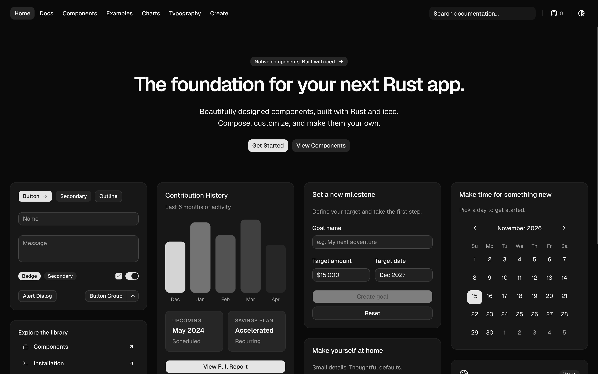

# icedcn

Widgets and themes for native Rust apps built with [iced](https://github.com/iced-rs/iced).

icedcn includes buttons, forms, menus, dialogs, tables, and layouts with shared
colors, spacing, and typography. Light and dark themes are built in. Widgets use
iced's usual `update` and `view` functions, and convert into `iced::Element`.

The library is under active development. APIs can change, and it currently uses
the `dev` branch of [airstrike/iced](https://github.com/airstrike/iced/tree/dev).

## Try it

Browse the components and examples at
[icedcn.airstrike.fyi](https://icedcn.airstrike.fyi/). Each page has
interactive previews and copyable Rust snippets.

<a href="https://icedcn.airstrike.fyi/"></a>

## Use it

Install Rust with [rustup](https://rustup.rs/), then create an application with
the icedcn CLI:

```sh
cargo install --git https://github.com/airstrike/icedcn --branch master icedcn_cli --locked
icedcn new my-app
cd my-app
cargo run
```

The CLI configures the application and toolchain. Commit the generated `Cargo.lock`.

For an existing project, run `icedcn toolchain` in its root. A conflicting
toolchain is reported without changing the file. Use `icedcn toolchain --update`
to change the channel while preserving components, targets, and other settings.

### Manual setup

Create an application:

```sh
cargo new my-app --edition 2024
cd my-app
```

Create `rust-toolchain.toml` in the project root:

```toml
[toolchain]
channel = "nightly-2026-07-11"
```

Replace the generated `[dependencies]` section in your application's `Cargo.toml` with:

```toml
[dependencies]
iced = "0.15.0-dev"
icedcn = { git = "https://github.com/airstrike/icedcn", branch = "master" }

[patch.crates-io]
iced = { git = "https://github.com/airstrike/iced.git", branch = "dev" }
iced_core = { git = "https://github.com/airstrike/iced.git", branch = "dev" }
iced_widget = { git = "https://github.com/airstrike/iced.git", branch = "dev" }
iced_runtime = { git = "https://github.com/airstrike/iced.git", branch = "dev" }

[patch."https://github.com/hecrj/cosmic-text.git"]
cosmic-text = { git = "https://github.com/airstrike/cosmic-text", branch = "dev" }
```

Cargo only applies patches from the root manifest. If your app belongs to a
Cargo workspace, put these patch tables in that workspace's root manifest and
use its lockfile. Keep the branch references in the patch tables: the lockfile
pins the commits, and the matching references let iced and its dependencies
share the same types.

Start with the default features; see the
[Cargo guide](https://icedcn.airstrike.fyi/docs/cargo#feature-flags) for
`chart`, `svg`, `markdown`, `highlighter`, `spinner`, and `sweeten`.

### Your first window

The CLI creates a starter application for you. If you followed the manual
setup, put this in `src/main.rs`:

```rust
use iced::Element;
use icedcn::Theme;
use icedcn::widget::{button, column, text};

#[derive(Default)]
struct Counter {
    count: u32,
}

#[derive(Debug, Clone)]
enum Message {
    Increment,
}

impl Counter {
    fn update(&mut self, message: Message) {
        match message {
            Message::Increment => self.count += 1,
        }
    }

    fn view(&self) -> Element<'_, Message, Theme> {
        column![
            text(format!("Count: {}", self.count)),
            button("Increment").on_press(Message::Increment),
        ]
        .spacing(12)
        .padding(24)
        .into()
    }
}

fn main() -> iced::Result {
    iced::application(Counter::default, Counter::update, Counter::view)
        .title("My icedcn application")
        .run()
}
```

Check the application, then open the window:

```sh
cargo check
cargo run
```

This example follows the system appearance and uses the system font. Choose a
variant with `.style(button::Outline)` or `.style(button::Destructive)`.
Controls such as inputs and checkboxes can keep their own state; supply a value
and a change handler when your application needs to own it. See
[Installation](https://icedcn.airstrike.fyi/docs/installation#icons) for the
generated Lucide icon module used by other examples.

## Google Fonts

Enable the optional `fount` feature to discover and load Google Fonts from any
icedcn application:

```toml
icedcn = { git = "https://github.com/airstrike/icedcn", branch = "master", features = ["fount"] }
```

`icedcn::fount::init()` returns an iced `Task` with catalog and system-font
messages. Store the returned catalog with `Fount::set_google_catalog` and the
system names with `Fount::set_system_families`. `Fount::families()` returns the
complete combined list; `Fount::search("sans")` searches it without a result cap.

```rust
use iced::Task;
use icedcn::fount;

fn choose_font(fonts: &fount::Fount, name: impl Into<String>) -> Task<fount::Message> {
    fount::load(name, fonts.google_catalog())
}
```

`Message::Loaded(name, Ok(()))` arrives after every face has been registered.
Apply the selected family through iced's font defaults or icedcn's design font
family. On failure, the existing font remains available.

Native apps use Google's catalog with a disk cache and an offline fallback.
Web apps use the complete bundled snapshot and CORS-safe TrueType downloads;
they do not require an API key or proxy. The snapshot currently contains 1,961
families, refreshed on 2026-11-15. Its provenance and refresh command are in
[vendor/fount/README.md](vendor/fount/README.md).

## Examples and development

The [component pages](examples/browser/src/component) pair previews with
[copyable examples](examples/browser/snippets). The
[palette app](examples/palette) shows widgets together in larger layouts.

```sh
cargo run -p browser
cargo run -p palette
cargo check -p browser
cargo test -p icedcn_widget
cargo test -p icedcn_core
```

## License

MIT. Bundled assets retain their own license notices.
