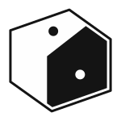

# icedcn

Widgets and themes for native Rust apps built with [iced](https://github.com/iced-rs/iced).

icedcn includes buttons, forms, menus, dialogs, tables, and layouts with shared
colors, spacing, and typography. Light and dark themes are built in. Widgets use
iced's usual `update` and `view` functions, and convert into `iced::Element`.

The library is under active development. APIs can change, and it currently uses
the `dev` branch of [airstrike/iced](https://github.com/airstrike/iced/tree/dev).

## Try it

Browse the [components and examples](https://icedcn.airstrike.fyi/), or run them locally.

With [Rust and rustup](https://rustup.rs/) installed:

```sh
git clone https://github.com/airstrike/icedcn.git
cd icedcn
cargo run --locked -p browser
```

Rustup uses the nightly pinned in [rust-toolchain.toml](rust-toolchain.toml).
The component browser has interactive previews and Rust snippets. For a full
screen of controls and theme settings, run `cargo run --locked -p palette`.

## Use it

Create an application with the CLI:

```sh
cargo install --git https://github.com/airstrike/icedcn --branch master icedcn_cli --locked
icedcn new my-app
cd my-app
cargo run
```

The CLI configures the dependencies and toolchain. No local icedcn checkout is needed.
See [Installation](https://icedcn.airstrike.fyi/docs/installation) for the manual setup.

Alternatively, add these dependencies to your application's `Cargo.toml`:

```toml
[dependencies]
iced = "0.15.0-dev"
icedcn = { git = "https://github.com/airstrike/icedcn", branch = "master" }
```

The manual setup also needs the fork patches and Rust toolchain listed in
[Installation](https://icedcn.airstrike.fyi/docs/installation#manual-setup).
Cargo does not inherit patches from a dependency. The CLI configures these for you.

Here is a complete `src/main.rs`:

```rust
use iced::Element;
use icedcn::Theme;
use icedcn::widget::{button, center, column, text};

#[derive(Default)]
struct Counter {
    value: u32,
}

#[derive(Debug, Clone)]
enum Message {
    Increment,
}

impl Counter {
    fn update(&mut self, message: Message) {
        match message {
            Message::Increment => self.value += 1,
        }
    }

    fn view(&self) -> Element<'_, Message, Theme> {
        center(
            column![
                text::h1(self.value.to_string()),
                button("Add one").on_press(Message::Increment),
            ]
            .spacing(16)
            .align_x(iced::Center),
        )
        .into()
    }
}

fn main() -> iced::Result {
    iced::application(Counter::default, Counter::update, Counter::view)
        .title("Counter")
        .theme(|_: &Counter| Theme::light())
        .run()
}
```

Choose a variant with `.style(button::Outline)` or
`.style(button::Destructive)`. Use `Theme::dark()` for the dark theme.
Controls such as inputs and checkboxes can keep their own state; supply a value
and a change handler when your application needs to own it.

## Google Fonts

Enable the optional `fount` feature to discover and load Google Fonts from any
icedcn application:

```toml
icedcn = { git = "https://github.com/airstrike/icedcn", branch = "master", features = ["fount"] }
```

`icedcn::fount::init()` returns an iced `Task` with catalog and system-font
messages. Store the returned catalog with `Fount::set_google_catalog` and the
system names with `Fount::set_system_families`. `Fount::families()` returns the
complete combined list; `Fount::search("sans")` searches it without a result cap.

```rust
use iced::Task;
use icedcn::fount;

fn choose_font(fonts: &fount::Fount, name: impl Into<String>) -> Task<fount::Message> {
    fount::load(name, fonts.google_catalog())
}
```

`Message::Loaded(name, Ok(()))` arrives after every face has been registered.
Apply the selected family through iced's font defaults or icedcn's design font
family. On failure, the existing font remains available.

Native apps use Google's catalog with a disk cache and an offline fallback.
Web apps use the complete bundled snapshot and CORS-safe TrueType downloads;
they do not require an API key or proxy. The snapshot currently contains 1,961
families, refreshed on 2026-11-15. Its provenance and refresh command are in
[vendor/fount/README.md](vendor/fount/README.md).

## Examples and development

The [component pages](examples/browser/src/component) pair previews with
[copyable examples](examples/browser/snippets). The
[palette app](examples/palette) shows widgets together in larger layouts.

```sh
cargo check --locked -p browser
cargo test --locked -p icedcn_widget
cargo test --locked -p icedcn_core
```

## License

MIT. Bundled assets retain their own license notices.
